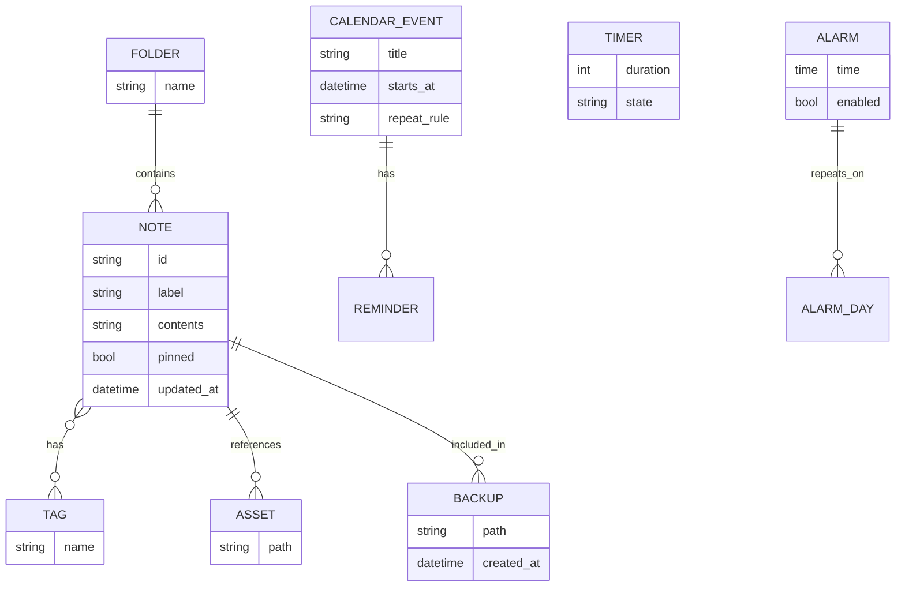
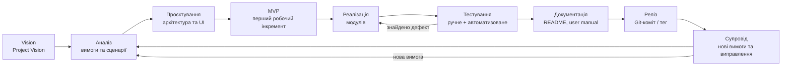
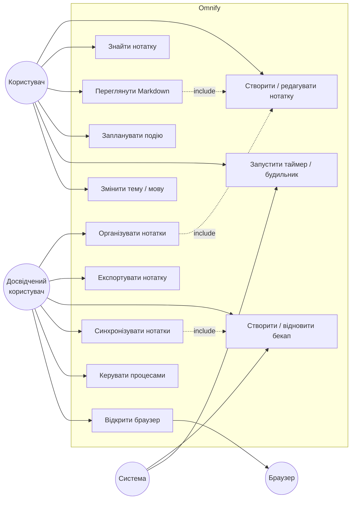
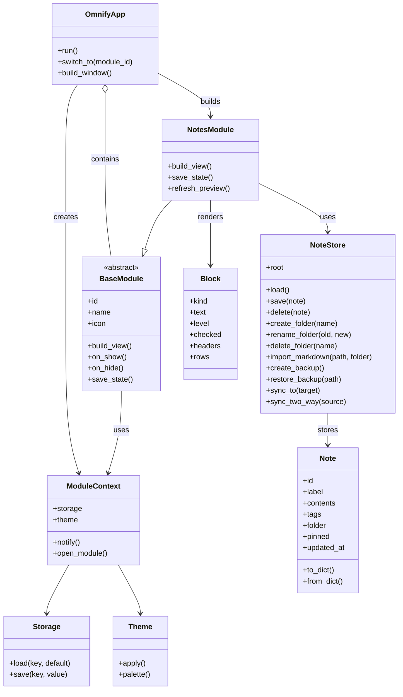
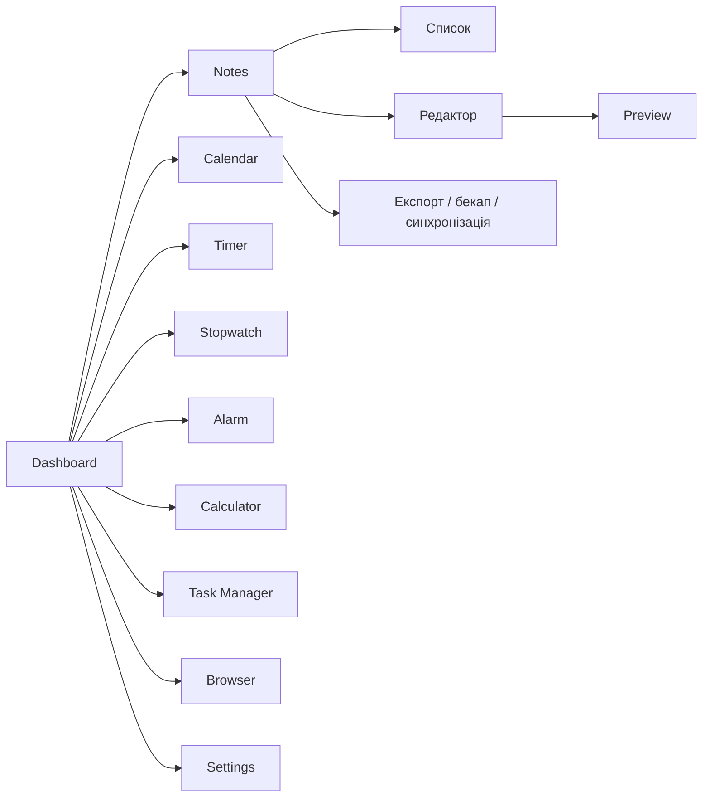
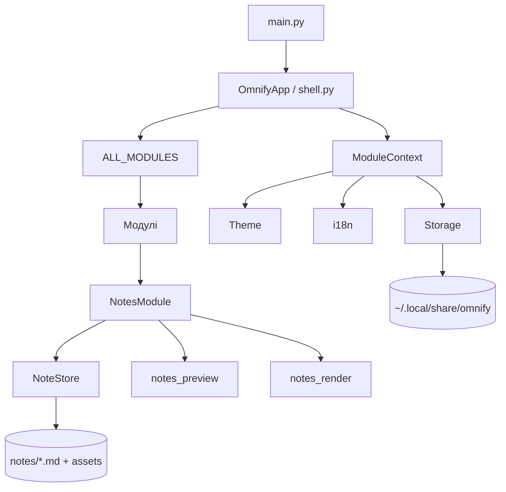

# Практичні роботи з програмної інженерії

## Проєкт: **Omnify**

**Тип документа:** звіт за практичними роботами №1–20  
**Проєкт:** Omnify — локальний настільний набір інструментів для Linux  
**Репозиторій:** <https://github.com/asdjfhaisufheirufiaref/omnify>  
**Основна гілка:** `main`  
**Мова інтерфейсу:** українська та англійська  
**Стан проєкту:** робочий GTK 4-застосунок, 435 автоматизованих тестів  
**Дата підготовки звіту:** 11 листопада 2026 року

> Цей файл об'єднує відповіді на всі практичні роботи. Уже реалізовані
> частини проєкту не переписувалися заново: для них наведено фактичний
> результат, посилання на файли, команди перевірки та коротке пояснення.
> Елементи, які потребують зовнішнього акаунта (Figma, GitHub push,
> GitHub Projects), позначені окремо.

---

## 0. Паспорт проєкту та наскрізна ідея

### 0.1. Короткий опис

**Omnify** — це локальний настільний застосунок, який об'єднує типові
щоденні інструменти в одному вікні: нотатки, календар, таймери, будильник,
калькулятор, менеджер задач, налаштування та приватний браузер.

### 0.2. Головна проблема

Користувач Linux часто змушений тримати відкритими багато окремих програм:
редактор нотаток, календар, таймер, калькулятор, менеджер процесів і
браузер. Це створює такі проблеми:

- дані розкидані між різними форматами та папками;
- частина програм потребує акаунта або інтернету;
- нотатки часто зберігаються в закритих базах даних, а не у звичайних файлах;
- дрібні інструменти мають різний вигляд і різні гарячі клавіші;
- немає єдиного місця для резервних копій і налаштувань.

### 0.3. Продуктове рішення

Omnify пропонує **local-first** підхід:

- один застосунок і одна навігаційна панель;
- дані зберігаються локально;
- нотатки — звичайні Markdown-файли;
- налаштування — JSON-файли в домашній папці користувача;
- резервні копії — ZIP-архіви;
- застосунок працює без обов'язкового інтернету та без реєстрації;
- інтерфейс підтримує українську та англійську мови.

### 0.4. Фактичний стан

| Показник | Значення |
| --- | --- |
| Мова реалізації | Python 3.10+ (перевірено на Python 3.14) |
| GUI | GTK 4 через PyGObject |
| Обов'язкові pip-залежності | немає |
| Модулі | Dashboard, Notes, Calendar, Timer, Stopwatch, Alarm, Calculator, Task Manager, Browser, Settings |
| Нотатки | Markdown, папки, теги, пошук, preview, експорт, бекапи, синхронізація |
| Автоматизовані тести | **435 тестів, усі проходять** |
| Основна гілка | `main` |
| Формат нотаток | `.md` + YAML-подібний front matter |

### 0.5. Основні команди

```bash
cd /home/sillycat/projects/omnify
python3 -m omnify
python3 -m py_compile $(find omnify tests -name '*.py')
python3 -m unittest discover -s tests
```

---

# Практична №1. Вступ до програмної інженерії та формування команди

## Мета

Ознайомитися з програмною інженерією, етапами створення продукту та
організувати роботу над навчальним проєктом.

## 1.1. Команда

**Назва команди:** «Omnify Team».  
**Формат:** навчальний індивідуальний проєкт; у разі командної роботи ролі
розподіляються між учасниками.

Оскільки в цьому проєкті немає підтверджених персональних даних інших
учасників, у документі визначено **ролі**, а не вигадані прізвища. Це
коректно і для індивідуального виконання: один студент може поєднувати
кілька ролей.

| Роль | Відповідальність | Основні артефакти |
| --- | --- | --- |
| Product Owner | Бачить проблему користувача, формує Vision і пріоритети | Project Vision, backlog |
| Аналітик | Описує предметну область, вимоги, сценарії | Вимоги, use cases |
| UI/UX-дизайнер | Проєктує екрани, навігацію, стани | Wireframes, прототип |
| Розробник | Реалізує модулі, пише код і тести | Код, commit-и |
| QA / тестувальник | Перевіряє позитивні та негативні сценарії | Test cases, bug reports |
| DevOps / документатор | Git, README, інструкції, реліз | Репозиторій, документація |

## 1.2. Назва продукту

**Omnify** походить від англійського *omni-* («усе») та *-fy* («робити»).
Назва передає ідею: один застосунок, який об'єднує кілька корисних
інструментів.

## 1.3. Project Vision

> **Для** студентів, викладачів, офісних працівників і користувачів Linux,
> які працюють із великою кількістю дрібних щоденних задач,  
> **які** втомилися перемикатися між різними програмами та хочуть зберігати
> дані локально,  
> **Omnify** — це настільний набір інструментів,  
> **який** об'єднує нотатки, календар, таймери, калькулятор, менеджер задач
> і приватний браузер в одному середовищі,  
> **на відміну від** розрізнених програм і хмарних сервісів,  
> **наш продукт** працює локально, не потребує обов'язкового акаунта та
> зберігає нотатки у відкритому Markdown-форматі.

## 1.4. Проблема

Користувач витрачає час на:

- перемикання між нотатником, календарем, таймером і калькулятором;
- пошук даних у різних місцях;
- ручне копіювання резервних копій;
- звикання до різних інтерфейсів;
- ризик втратити дані через закриті формати або хмарну залежність.

## 1.5. Цільові користувачі

1. **Студенти** — конспекти, дедлайни, таймер для навчання.
2. **Викладачі** — планування занять, нотатки, нагадування.
3. **Офісні працівники** — задачі, календар, швидкі нотатки.
4. **Користувачі Linux** — люди, які цінують локальні дані та відкриті формати.
5. **Люди, чутливі до приватності** — ті, хто не хоче зберігати особисті
   нотатки в чужій хмарі.

## 1.6. Опис продукту

Omnify складається з таких основних частин:

- головний Dashboard із годинником і швидкими діями;
- Notes — Markdown-нотатки, папки, теги, картинки, preview, експорт, бекапи;
- Calendar — події, нагадування, повторення, статистика;
- Timer / Stopwatch / Alarm — робота з часом;
- Calculator — науковий калькулятор з історією та графіками;
- Task Manager — процеси, продуктивність, сервіси;
- Browser — керований LibreWolf/Firefox і Tor Browser;
- Settings — теми, мова, шрифти, фон, імпорт/експорт налаштувань.

## 1.7. Критерії успіху

- застосунок запускається однією командою;
- користувач може створити нотатку, знайти її, експортувати та зробити бекап;
- таймери й будильники працюють у фоні;
- інтерфейс не потребує акаунта;
- дані можна знайти у звичайних файлах;
- тести підтверджують стабільність базової логіки.

**Результат:** сформовано команду/ролі, назву, бачення, проблему, цільових
користувачів і короткий опис продукту.

---

# Практична №2. Аналіз проблеми, користувачів та предметної області

## 2.1. Формулювання проблеми

**Проблема:** користувач витрачає час і увагу на перемикання між багатьма
непов'язаними інструментами, а його дані залишаються розрізненими та
залежними від конкретної програми або хмарного сервісу.

**Наслідки:**

- втрата контексту під час перемикання;
- дублювання інформації;
- складність пошуку;
- ризик втрати даних;
- зайві витрати часу на налаштування.

## 2.2. Потреби користувачів

| Потреба | Що хоче користувач | Рішення в Omnify |
| --- | --- | --- |
| Швидкий запис | Створити нотатку за кілька секунд | Кнопка `+`, автозбереження |
| Порядок | Розкласти нотатки за папками й тегами | Папки, теги, пошук |
| Наочність | Бачити структуру тексту | Markdown-preview |
| Безпека | Не втратити текст | Autosave, ZIP-бекапи |
| Переносність | Відкрити нотатки іншою програмою | Markdown-файли |
| Приватність | Не відправляти дані в хмару | Local-first |
| Контроль часу | Запускати таймери й нагадування | Timer, Alarm, Calendar |
| Єдиний стиль | Не звикати до різних UI | Спільна тема та навігація |

## 2.3. Цільова аудиторія

### Основна аудиторія

- студенти та школярі;
- викладачі;
- офісні працівники;
- користувачі Linux із досвідом від початкового до просунутого.

### Другорядна аудиторія

- люди, які ведуть особисті проєкти;
- користувачі, чутливі до приватності;
- користувачі, які хочуть мати локальні Markdown-файли.

### Нецільова аудиторія

- великі команди, яким потрібна складна корпоративна система;
- користувачі, яким обов'язково потрібні мобільні застосунки та хмарна
  синхронізація в реальному часі;
- користувачі, які очікують повноцінний офісний пакет.

## 2.4. Основні об'єкти предметної області

| Об'єкт | Призначення | Основні поля/зв'язки |
| --- | --- | --- |
| `Note` | Одна Markdown-нотатка | `id`, `label`, `contents`, `tags`, `folder`, `pinned`, `updated_at` |
| `NoteStore` | Читання/запис нотаток | корінь `notes/`, `assets/`, бекапи |
| `Folder` | Папка нотаток | назва, шлях, належність нотаток |
| `Tag` | Мітка нотатки | назва, зв'язок «багато до багатьох» із нотатками |
| `Asset` | Картинка нотатки | шлях `assets/<note-id>/...` |
| `CalendarEvent` | Подія календаря | дата, час, назва, нагадування, повторення |
| `Reminder` | Нагадування | час, подія, стан |
| `Timer` | Таймер | тривалість, стан, залишок |
| `Alarm` | Будильник | час, дні тижня, звук, snooze |
| `Process` | Процес системи | PID, назва, CPU, RAM, стан |
| `Theme` | Оформлення | режим, акцент, шрифт, радіус |
| `Backup` | ZIP-архів | дата, вміст, шлях |

## 2.5. Взаємозв'язки між об'єктами



## 2.6. Основні сценарії використання

1. **Ранкове планування.** Користувач відкриває Dashboard, дивиться
   календар, створює нотатку з планом і ставить нагадування.
2. **Навчальна сесія.** Користувач запускає таймер, веде конспект у Notes,
   позначає виконані пункти чекліста.
3. **Пошук інформації.** Користувач вводить `#навчання` або частину назви й
   знаходить потрібну нотатку.
4. **Експорт і передача.** Користувач експортує нотатку в HTML/PDF або
   імпортує зовнішній Markdown-файл.
5. **Резервне копіювання.** Omnify створює щоденний ZIP-архів; користувач
   може відновити дані.
6. **Контроль системи.** Користувач відкриває Task Manager, знаходить
   процес, який споживає ресурси, і безпечно завершує його.

## 2.7. Межі системи

### Що входить у систему

- локальне зберігання нотаток, календаря, таймерів і налаштувань;
- GUI та навігація між модулями;
- пошук, фільтрація, теги, папки;
- експорт, імпорт, бекапи;
- локальна синхронізація з вибраною папкою;
- інтеграція з браузером через окремий Launcher.

### Що не входить

- власна хмарна інфраструктура та акаунти;
- двостороння синхронізація в реальному часі між пристроями;
- мобільний застосунок;
- спільне редагування нотаток;
- офісний пакет із таблицями та презентаціями;
- антивірус або повноцінний файловий менеджер.

**Результат:** описано проблему, потреби, аудиторію, об'єкти, зв'язки,
сценарії та межі системи.

---

# Практична №3. Життєвий цикл програмного забезпечення

## 3.1. Порівняння моделей

| Модель | Сильні сторони | Слабкі сторони | Коли доречна |
| --- | --- | --- | --- |
| Waterfall | Чіткі етапи, прості звіти | Пізній зворотний зв'язок, дорогі зміни | Стабільні вимоги |
| V-model | Сильна увага до тестування | Жорстка послідовність | Критичні системи |
| Incremental | Швидкі робочі версії | Потрібне планування інтеграції | Продукт можна ділити на модулі |
| Spiral | Аналіз ризиків | Складна для малих проєктів | Високоризикові проєкти |
| Scrum | Гнучкість, регулярні інкременти | Потрібна команда й ритуали | Командна розробка |
| Kanban | Візуалізація потоку, гнучкість | Може бракувати довгострокового плану | Постійний потік задач |
| Prototype | Швидка перевірка UI | Ризик «прототипу назавжди» | Неясні вимоги |

## 3.2. Обрана модель

Для Omnify обрано **інкрементну ітеративну модель з елементами Kanban**:

- продукт складається з окремих модулів;
- кожен модуль можна реалізувати й перевірити окремо;
- вимоги уточнюються після кожного інкременту;
- тести виконуються після кожної зміни;
- Kanban допомагає бачити стан задач і обмежувати кількість роботи
  «в процесі».

## 3.3. Схема життєвого циклу



## 3.4. Етапи та результати

| Етап | Що робимо | Результат |
| --- | --- | --- |
| 1. Ініціація | Визначаємо проблему, користувачів, Vision | Project Vision |
| 2. Аналіз | Вимоги, user stories, use cases | Backlog і специфікація |
| 3. Проєктування | Архітектура, класи, UI | Схеми та wireframes |
| 4. MVP | Мінімальний робочий продукт | Запуск, Dashboard, Notes, Timer |
| 5. Ітерації | Нові модулі та покращення | Функціональний прототип |
| 6. Тестування | Позитивні/негативні сценарії | 435 тестів, OK |
| 7. Документація | README, інструкції, звіт | Готовий репозиторій |
| 8. Супровід | Нові вимоги, багфікси | Нові версії |

## 3.5. Обґрунтування вибору

1. **Модульність.** Omnify складається з незалежних інструментів; їх можна
   випускати інкрементами.
2. **Невизначеність вимог.** На старті не було остаточного списку функцій;
   ітерації дозволили додати Notes, теги, експорт і синхронізацію поступово.
3. **Потреба у зворотному зв'язку.** Preview, експорт і бекапи краще
   перевіряти на робочому продукті.
4. **Обмежені ресурси.** Один розробник не може ефективно вести важкий
   Waterfall-процес; Kanban дає гнучкість.
5. **Безпека.** Після кожної ітерації є можливість відкотитися до
   попереднього коміту та перевірити тести.

**Результат:** схема життєвого циклу та обґрунтування обраної моделі.

---

# Практична №4. Формування вимог до програмного забезпечення

## 4.1. Користувачі системи

| Користувач | Основна мета | Рівень підготовки |
| --- | --- | --- |
| Студент | Вести конспекти й планувати навчання | Початковий |
| Викладач | Планувати заняття та нагадування | Середній |
| Офісний працівник | Керувати задачами й нотатками | Середній |
| Користувач Linux | Отримати локальний інструмент | Від початкового до просунутого |
| Адміністратор | Керувати процесами й налаштуваннями | Просунутий |

## 4.2. Функціональні вимоги

| ID | Вимога | Пріоритет |
| --- | --- | --- |
| FR-01 | Застосунок запускається однією командою та відкриває головне вікно | Must |
| FR-02 | Користувач може перемикатися між модулями через sidebar | Must |
| FR-03 | Notes створює, редагує, зберігає та видаляє нотатки | Must |
| FR-04 | Нотатки зберігаються як Markdown-файли зі стабільним `id` | Must |
| FR-05 | Notes підтримує папки, переміщення та перейменування | Should |
| FR-06 | Notes підтримує теги, пошук за текстом і `#тегом` | Must |
| FR-07 | Notes підтримує чеклісти, таблиці, картинки | Must |
| FR-08 | Notes має preview без зовнішнього браузера | Must |
| FR-09 | Notes експортує нотатку в HTML/PDF | Should |
| FR-10 | Notes створює та відновлює ZIP-бекапи | Must |
| FR-11 | Notes синхронізує дані з локальною папкою | Should |
| FR-12 | Calendar підтримує події та нагадування | Should |
| FR-13 | Timer, Stopwatch і Alarm працюють у фоні | Must |
| FR-14 | Settings зберігає мову й тему між запусками | Should |
| FR-15 | Task Manager показує процеси та дозволяє безпечно їх завершувати | Could |
| FR-16 | Browser відкриває керований LibreWolf/Firefox | Could |
| FR-17 | Користувач може імпортувати зовнішні Markdown-файли | Should |

## 4.3. Нефункціональні вимоги

| ID | Вимога | Критерій |
| --- | --- | --- |
| NFR-01 | Local-first | Основні функції працюють без інтернету |
| NFR-02 | Приватність | Нотатки не надсилаються на сервер |
| NFR-03 | Переносність | Нотатки відкриваються іншими Markdown-редакторами |
| NFR-04 | Продуктивність | Базові дії UI не блокують вікно на помітний час |
| NFR-05 | Надійність | Запис файлів атомарний; є бекапи |
| NFR-06 | Відновлюваність | Пошкоджений/видалений файл можна відновити з ZIP |
| NFR-07 | Локалізація | Інтерфейс EN/UA, рядки винесені в локалі |
| NFR-08 | Доступність | Кнопки мають tooltips; текст можна виділяти |
| NFR-09 | Сумісність | Linux, Python 3.10+, GTK 4 |
| NFR-10 | Тестованість | Бізнес-логіка відокремлена від GTK і покрита unittest |
| NFR-11 | Супроводжуваність | Модулі мають єдиний інтерфейс `BaseModule` |
| NFR-12 | Безпека шляхів | Заборонено вихід за межі `notes/` та `assets/` |
| NFR-13 | Відсутність root | Встановлення та робота без прав адміністратора |

## 4.4. Пріоритети

### Must have

- запуск застосунку;
- Notes: створення, редагування, збереження, пошук;
- Markdown-зберігання;
- базові таймери;
- налаштування мови/теми;
- бекапи нотаток.

### Should have

- папки, теги, картинки, preview;
- експорт HTML/PDF;
- календар і нагадування;
- синхронізація;
- імпорт Markdown.

### Could have

- Task Manager;
- Browser із керованим профілем;
- графіки калькулятора;
- додаткові теми й акценти.

## 4.5. Критерії приймання основних вимог

**FR-03:**

- нотатка створюється кнопкою `+`;
- після введення тексту файл з'являється в `notes/`;
- після перезапуску нотатка відновлюється.

**FR-04:**

- у front matter є `id`, `title`, `tags`, `updated_at`;
- зміна назви не змінює `id`;
- файл можна відкрити іншим Markdown-редактором.

**FR-06:**

- запит `#work` показує нотатки з тегом `work`;
- пошук без `#` шукає назву, текст і теги;
- регістр не має значення.

**FR-10:**

- ZIP містить `.md` і `assets/`;
- після видалення нотатки її можна відновити з архіву;
- перед відновленням створюється страхувальна копія.

**Результат:** документ вимог із функціональними, нефункціональними
вимогами, пріоритетами та критеріями приймання.

---

# Практична №5. User Stories та критерії приймання

## 5.1. Формат User Story

```text
As a <роль>,
I want <дія>,
so that <цінність>.
```

Критерії приймання записані у форматі перевірюваних тверджень
(`Given / When / Then` або чекліст).

## 5.2. Backlog User Stories

### US-01. Створення нотатки

**Як** студент, **я хочу** створити нову нотатку однією кнопкою, **щоб**
швидко записати думку.

**Пріоритет:** Must. **Оцінка:** 2 бали.

**Критерії приймання:**

- [ ] кнопка `+` створює нотатку з назвою «Untitled»;
- [ ] нотатка з'являється у списку й відкривається в редакторі;
- [ ] після введення тексту файл зберігається автоматично;
- [ ] після перезапуску нотатка залишається.

### US-02. Папки

**Як** користувач, **я хочу** групувати нотатки за папками, **щоб** не
губитися у великому списку.

**Пріоритет:** Should. **Оцінка:** 3 бали.

**Критерії приймання:**

- [ ] можна створити папку з назвою;
- [ ] нотатку можна перемістити в папку;
- [ ] фільтр показує лише нотатки вибраної папки;
- [ ] видалення папки переносить нотатки в «Без папки», а не знищує їх;
- [ ] папку можна перейменувати.

### US-03. Теги й пошук

**Як** користувач, **я хочу** позначати нотатки тегами та шукати за ними,
**щоб** швидко знаходити потрібне.

**Пріоритет:** Must. **Оцінка:** 3 бали.

**Критерії приймання:**

- [ ] теги вводяться через кому;
- [ ] теги відображаються в рядку нотатки;
- [ ] пошук `#work` фільтрує за тегом;
- [ ] пошук без `#` перевіряє назву, текст і теги;
- [ ] є підказки вже відомих тегів.

### US-04. Картинки

**Як** студент, **я хочу** вставити картинку з буфера або файлу, **щоб**
додати схему до конспекту.

**Пріоритет:** Should. **Оцінка:** 3 бали.

**Критерії приймання:**

- [ ] `Ctrl+V` вставляє PNG/JPEG/WebP з буфера;
- [ ] кнопка `🖼` відкриває вибір файлу;
- [ ] картинка копіюється в `notes/assets/<id>/`;
- [ ] у Markdown залишається посилання ``;
- [ ] картинка видима в редакторі та preview.

### US-05. Preview і чеклісти

**Як** користувач, **я хочу** бачити форматований текст і перемикати
чеклісти, **щоб** працювати з планом без окремого редактора.

**Пріоритет:** Must. **Оцінка:** 5 балів.

**Критерії приймання:**

- [ ] Preview показує заголовки, абзаци, списки, таблиці, код і картинки;
- [ ] чекбокси в preview відображають стан `- [ ]` / `- [x]`;
- [ ] натискання чекбокса змінює Markdown-файл;
- [ ] після перезапуску стан чекліста зберігається.

### US-06. Експорт

**Як** користувач, **я хочу** експортувати нотатку, **щоб** поділитися нею
або роздрукувати.

**Пріоритет:** Should. **Оцінка:** 5 балів.

**Критерії приймання:**

- [ ] HTML-файл відкривається без папки `notes/`;
- [ ] картинки в HTML вбудовані як `data:` URI;
- [ ] PDF містить заголовок, текст, таблиці та картинки;
- [ ] можна експортувати всі нотатки з `index.html`.

### US-07. Бекапи

**Як** користувач, **я хочу** мати резервні копії, **щоб** відновити дані
після помилки.

**Пріоритет:** Must. **Оцінка:** 5 балів.

**Критерії приймання:**

- [ ] ручний бекап створює ZIP;
- [ ] автоматичний бекап створюється не частіше одного разу на добу;
- [ ] зберігається до 10 архівів;
- [ ] відновлення додає нотатки з архіву;
- [ ] перед відновленням створюється страхувальна копія.

### US-08. Синхронізація

**Як** користувач, **я хочу** синхронізувати нотатки з локальною папкою,
**щоб** використовувати Syncthing або Dropbox без прив'язки до акаунта
Omnify.

**Пріоритет:** Should. **Оцінка:** 5 балів.

**Критерії приймання:**

- [ ] одностороння синхронізація копіює `notes/` у вибрану папку;
- [ ] двостороння синхронізація об'єднує нотатки за `id`;
- [ ] новіша версія визначається за `updated_at`;
- [ ] папка всередині `notes/` заборонена;
- [ ] перед двостороннім merge створюється бекап.

### US-09. Таймер

**Як** студент, **я хочу** запустити таймер на 25 хвилин, **щоб**
працювати за технікою Pomodoro.

**Пріоритет:** Must. **Оцінка:** 3 бали.

**Критерії приймання:**

- [ ] можна створити таймер із довільним часом;
- [ ] таймер продовжує роботу після закриття вікна в трей;
- [ ] після завершення з'являється нагадування/звук;
- [ ] стан відновлюється після перезапуску.

### US-10. Мова й тема

**Як** користувач, **я хочу** змінити мову та тему, **щоб** налаштувати
застосунок під себе.

**Пріоритет:** Should. **Оцінка:** 2 бали.

**Критерії приймання:**

- [ ] доступні англійська та українська;
- [ ] зміна мови застосовується до інтерфейсу;
- [ ] тема та акцент зберігаються після перезапуску;
- [ ] є світла, темна та системна теми.

## 5.3. Перевірка User Stories

| Критерій | Результат |
| --- | --- |
| Є роль користувача | Так |
| Є конкретна дія | Так |
| Є цінність/результат | Так |
| Є критерії приймання | Так |
| Критерії перевірювані | Так |
| Немає технічних деталей замість користувацької мети | Так |
| Історії не дублюють одна одну | Так |

## 5.4. Definition of Ready / Done

**Definition of Ready:**

- зрозуміла роль і мета;
- є критерії приймання;
- відомі залежності;
- історія достатньо мала для однієї ітерації.

**Definition of Done:**

- код реалізовано;
- є тести або ручний чекліст;
- оновлено документацію/локалізацію;
- перевірено позитивний і негативний сценарій;
- зміни закомічено.

**Результат:** backlog User Stories із критеріями приймання та означенням
готовності.

---

# Практична №6. Аналіз предметної області та Use Case Diagram

## 6.1. Актори

| Актор | Опис | Основні можливості |
| --- | --- | --- |
| Користувач | Звичайний користувач застосунку | Нотатки, календар, таймери, налаштування |
| Досвідчений користувач | Працює з папками, експортом, синхронізацією | Імпорт, бекапи, Task Manager |
| Система | Внутрішні сервіси | Автозбереження, нагадування, бекапи |
| Зовнішній браузер | LibreWolf/Firefox/Tor | Відкриття вебсторінок |

## 6.2. Use Case Diagram



## 6.3. Use Case 1: створити та відредагувати нотатку

**ID:** UC-01  
**Актор:** Користувач  
**Передумова:** застосунок запущено, відкрито модуль Notes.

**Основний потік:**

1. Користувач натискає `+`.
2. Система створює нову нотатку й відкриває редактор.
3. Користувач вводить назву та текст.
4. Система через 900 мс зберігає Markdown-файл.
5. Користувач перемикає Preview.
6. Система показує відформатований текст.

**Альтернативи:**

- порожня назва → використовується «Untitled»;
- помилка запису → повідомлення в статус-барі, текст залишається в редакторі;
- нотатка містить картинку → вона копіюється в `assets/<id>/`.

**Післяумова:** нотатка існує у списку та на диску.

## 6.4. Use Case 2: запланувати подію

**ID:** UC-02  
**Актор:** Користувач  
**Передумова:** відкрито Calendar.

**Основний потік:**

1. Користувач вибирає дату.
2. Натискає «Створити подію».
3. Вводить назву, час, опис.
4. За потреби додає нагадування або повторення.
5. Система зберігає подію.
6. Система показує подію в календарі.

**Альтернативи:**

- некоректний час → підказка й відмова зберегти;
- повторення → подія з'являється у вибраному діапазоні;
- нагадування → системне повідомлення у визначений час.

**Післяумова:** подія збережена й відображається.

## 6.5. Use Case 3: запустити таймер

**ID:** UC-03  
**Актор:** Користувач  
**Передумова:** відкрито Timer.

**Основний потік:**

1. Користувач вводить тривалість.
2. Натискає «Старт».
3. Система зберігає стан і запускає зворотний відлік.
4. Користувач згортає вікно.
5. Після завершення система показує нагадування та грає звук.

**Альтернативи:**

- пауза → залишок часу зберігається;
- перезапуск застосунку → таймер відновлюється;
- скасування → таймер зупиняється без звуку.

**Післяумова:** таймер завершено або збережено в новому стані.

**Результат:** діаграма use cases і три описані сценарії.

---

# Практична №7. Проєктування структури програмного забезпечення

## 7.1. Основні компоненти

| Компонент | Відповідальність |
| --- | --- |
| `omnify.app.shell` | Головне вікно, sidebar, навігація, статус-бар, tray, settings UI |
| `core.storage` | Атомарне JSON-збереження налаштувань і стану |
| `core.theme` | Кольори, CSS, теми, акценти |
| `core.i18n` | Локалізація та переклад віджетів |
| `core.module_context` | `ModuleContext`, `BaseModule`, `Settings` |
| `modules.notes_engine` | Модель `Note`, `NoteStore`, файли, бекапи, sync |
| `modules.notes_render` | Markdown → HTML/PDF |
| `modules.notes_preview` | Markdown → GTK preview |
| `modules.notes` | GTK-інтерфейс Notes |
| `modules.calculator` | Калькулятор і графіки |
| `modules.calendar` | Календар, події, нагадування |
| `modules.timer` | Таймери |
| `modules.stopwatch` | Секундомір |
| `modules.alarm` | Будильники |
| `modules.taskmanager` | Процеси та продуктивність |
| `modules.browser` | Керування браузером |

## 7.2. Основні сутності

- `Note` — нотатка;
- `NoteStore` — сховище нотаток;
- `Block` — блок Markdown;
- `CalendarEvent` — подія;
- `Reminder` — нагадування;
- `Timer` / `Alarm` — часові об'єкти;
- `Theme` — оформлення;
- `ModuleContext` — залежності модуля;
- `Storage` — JSON-сховище;
- `BaseModule` — контракт модуля.

## 7.3. Спрощена Class Diagram



## 7.4. Пояснення проєктних рішень

1. **Headless-ядро.** `Note`, `NoteStore`, Markdown-парсер не імпортують GTK
   на рівні модуля, тому тести не потребують графічного сесії.
2. **Єдиний контракт модуля.** Кожен інструмент реалізує `BaseModule` і
   додається до `ALL_MODULES`.
3. **Local-first.** Нотатки — файли, а не записи в закритій БД.
4. **Стабільний `id`.** Назва файлу може змінюватися, але ідентичність
   нотатки зберігається у front matter.
5. **Безпека шляхів.** `resolve_asset` та `_folder_path` перевіряють, що
   шлях не виходить за межі `notes/`.
6. **Атомарний запис.** `Storage` і `NoteStore` пишуть тимчасовий файл, а
   потім роблять `replace`, щоб не залишити напівзаписаний файл.
7. **Розділення рендерингу.** `notes_render` використовується і preview, і
   HTML/PDF, тому поведінка узгоджена.

**Результат:** Class Diagram і опис структури.

---

# Практична №8. Проєктування інтерфейсу користувача

## 8.1. Основні екрани

| Екран | Призначення |
| --- | --- |
| Dashboard | Огляд, годинник, швидкі дії |
| Notes | Список нотаток, редактор, preview |
| Calendar | Тиждень/день/місяць, події |
| Timer | Створення та запуск таймерів |
| Stopwatch | Вимірювання часу, laps |
| Alarm | Список будильників |
| Calculator | Введення виразів, історія, графік |
| Task Manager | Процеси, продуктивність, сервіси |
| Browser | Керування браузером і профілем |
| Settings | Мова, тема, акцент, фон тощо |

## 8.2. Навігація



## 8.3. Wireframe екрана Notes

```text
┌─────────────────────────────── Omnify ───────────────────────────────┐
│ Sidebar          │  [ Назва нотатки................ ] 📌 🖼 ☑ ▦ 👁 ⋮ │
│ + Notes          │  Теги: [work, ideas..............] 📁             │
│ [Пошук........]  │  [ B ][ I ][ S ][ H ][ • ][ 1. ][ ❝ ][ </> ][ 🔗]│
│ [Усі нотатки ▾]  │ ┌───────────────────────────────────────────────┐ │
│ [Теги ▾]         │ │ # План на тиждень                             │ │
│ ┌─────────────┐  │ │                                               │ │
│ │ 📌 План     │  │ │ - [x] підготувати звіт                        │ │
│ │ Заголовок   │  │ │ - [ ] перевірити тести                        │ │
│ │ #work       │  │ │                                               │ │
│ ├─────────────┤  │ │ | День | Справа |                            │ │
│ │ Ідеї        │  │ │ | ---  | ---    |                            │ │
│ │ ...         │  │ │ | Пн   | Матем. |                            │ │
│ └─────────────┘  │ └───────────────────────────────────────────────┘ │
│                  │  12 слів · 84 символи              Збережено     │
└───────────────────────────────────────────────────────────────────────┘
```

## 8.4. Основні користувацькі сценарії

1. **Створити нотатку:** `+` → назва → текст → autosave → Preview.
2. **Знайти нотатку:** пошук або тег → вибір рядка → редагування.
3. **Додати картинку:** `Ctrl+V` або `🖼` → файл у `assets` → preview.
4. **Експортувати:** `⋮` → HTML/PDF → вибір файлу.
5. **Зробити бекап:** `⋮` → Backup notes → ZIP.
6. **Запустити таймер:** Timer → тривалість → Start → згорнути вікно.

## 8.5. Прототип

У цьому проєкті **Figma-макет не створювався**, оскільки для нього потрібен
зовнішній акаунт і доступ до Figma. Замість статичного макета реалізовано
**робочий GTK-прототип**, який можна запустити командою `python3 -m omnify`.
Wireframes вище відображають структуру екранів і переходи.

Якщо викладач вимагає саме посилання на Figma, його потрібно створити
вручну в акаунті Figma; це єдина зовнішня частина практичної №8.

## 8.6. Відповідність інтерфейсу вимогам

| Вимога | Як перевірено |
| --- | --- |
| FR-02 | Sidebar містить усі модулі |
| FR-03 | Кнопка `+`, редактор, автозбереження |
| FR-05 | Фільтр папок, кнопка `📁` |
| FR-06 | Поле пошуку, меню тегів |
| FR-07 | Кнопки `☑`, `▦`, вставка картинок |
| FR-08 | Toggle Preview |
| FR-09 | Меню `⋮` → Export |
| FR-10 | Меню `⋮` → Backup |
| NFR-07 | Перемикач мови в Settings |

**Результат:** перелік екранів, навігація, wireframes, сценарії та
відповідність вимогам; робочий прототип замість Figma.

---

# Практична №9. Основи Git та GitHub

## 9.1. Що вже налаштовано

- Git-репозиторій ініціалізовано в `/home/sillycat/projects/omnify`;
- основна гілка — `main`;
- налаштовано remote `origin`;
- створено `.gitignore`;
- створено `README.md`;
- є історія комітів;
- є локальні гілки та remote-tracking гілка `origin/main`.

Фактичні дані:

```text
origin  https://github.com/asdjfhaisufheirufiaref/omnify.git (fetch)
origin  https://github.com/asdjfhaisufheirufiaref/omnify.git (push)

* main
  remotes/origin/main
```

## 9.2. Основні команди

```bash
git init
git status
git add .
git commit -m "Add notes folders, tags, preview and export"
git log --oneline --graph --decorate
git remote add origin https://github.com/asdjfhaisufheirufiaref/omnify.git
git branch
git branch feature/notes-import
git checkout feature/notes-import
git clone https://github.com/asdjfhaisufheirufiaref/omnify.git
git pull origin main
git push origin main
```

## 9.3. .gitignore

У репозиторії виключені:

- `__pycache__/`, `*.pyc`;
- віртуальні середовища;
- логи;
- `/notes/` — особисті Markdown-нотатки та картинки;
- `/browser/` — локальний профіль браузера;
- `*.sqlite`, `*.db`;
- кеші тестів і редакторів.

Це важливо, бо нотатки користувача не повинні потрапляти в публічний Git.

## 9.4. Історія змін

Приклади комітів у проєкті:

```text
4cb265a Add Markdown import for external notes
00233a9 Add tag autocomplete and keyboard save/search shortcuts
d073bfa Show note excerpts in the notes list
11adb62 Add tag filters, folder rename, bundle export and two-way sync
9511ae4 Add note pinning, formatting toolbar and editor stats
68d73b4 Add notes folders, tags, preview and export
b3fbf7e Add inline Notes images and clipboard paste
d6a6eb8 Omnify v1.0.1
```

Перегляд історії:

```bash
git log --oneline --graph --decorate --all
git show 4cb265a --stat
git diff HEAD~1..HEAD
```

## 9.5. Стан синхронізації з GitHub

Локальний `main` містить коміти, яких ще немає в `origin/main`. Автоматичний
`git push` із цього середовища не виконується, бо немає збережених
облікових даних GitHub:

```text
could not read Username for 'https://github.com'
```

Для завершення практичної №9 потрібно виконати у власному терміналі:

```bash
cd /home/sillycat/projects/omnify
git push origin main
```

Якщо Git запитає пароль, використати **Personal Access Token** GitHub, а не
пароль від акаунта.

**Результат:** репозиторій, `.gitignore`, README, історія комітів, гілки та
remote налаштовані; залишилося виконати push із наявними правами.

---

# Практична №10. Командна робота з Git та GitHub

## 10.1. Модель роботи

Для команди обрано **feature-branch workflow**:

- `main` — стабільна гілка;
- `feature/<коротка-назва>` — окрема гілка для задачі;
- після завершення — Pull Request;
- code review — перевірка іншим учасником;
- merge у `main`;
- після merge — видалення feature-гілки.

## 10.2. Правила

1. Одна задача — одна гілка.
2. Коміти мають бути невеликими та змістовними.
3. Перед PR — `git pull --rebase origin main`.
4. PR містить опис, скріншоти/приклади та тести.
5. Код review перевіряє логіку, безпеку шляхів, тести й локалізацію.
6. Merge конфліктів вирішується вручну з повторним запуском тестів.

## 10.3. Приклад команд

```bash
git checkout main
git pull origin main
git checkout -b feature/notes-import
# ... зміни ...
git add omnify/modules/notes_engine.py tests/test_notes_store.py
git commit -m "Add Markdown import for external notes"
git push -u origin feature/notes-import
```

Після цього на GitHub:

1. Відкрити Pull Request.
2. Додати опис змін.
3. Призначити reviewer.
4. Виправити зауваження.
5. Виконати Merge.

## 10.4. Конфлікт і його вирішення

Приклад ситуації: двоє учасників змінили той самий рядок у
`README.md` або `notes.py`.

```bash
git checkout main
git pull origin main
git checkout feature/notes-import
git rebase main
# Git повідомляє: CONFLICT (content): Merge conflict in ...
```

У файлі з'являються маркери:

```text
<<<<<<< HEAD
старий варіант
=======
новий варіант
>>>>>>> feature/notes-import
```

Порядок дій:

1. Відкрити файл і залишити коректний варіант.
2. Видалити маркери конфлікту.
3. Запустити тести.
4. `git add <файл>`.
5. `git rebase --continue`.
6. Повторити push і PR.

## 10.5. Code review checklist

- чи відповідає зміна User Story;
- чи є тести;
- чи не порушена безпека шляхів;
- чи не зламана локалізація;
- чи немає дублювання логіки;
- чи оновлено документацію;
- чи проходять усі тести.

## 10.6. Фактичний стан

Проєкт виконувався в індивідуальному середовищі, тому реальні Pull Requests
між різними людьми не створювалися. Локально використовувалася та сама
модель: окремі смислові коміти, перевірка тестами, merge у `main`.
Для повного зарахування командної частини потрібно створити PR на GitHub
після появи доступу до акаунта.

**Результат:** описано workflow, гілки, PR, review, merge та конфлікти;
локальна частина виконана, GitHub-частина потребує push/PR.

---

# Практична №11. Архітектура та структура програмного проєкту

## 11.1. Фактична структура

```text
omnify/
├── omnify/
│   ├── __init__.py
│   ├── __main__.py
│   ├── main.py
│   ├── app/
│   │   ├── __init__.py
│   │   └── shell.py
│   ├── core/
│   │   ├── alerts.py
│   │   ├── dbus_min.py
│   │   ├── i18n.py
│   │   ├── input_monitor.py
│   │   ├── logfile.py
│   │   ├── module_context.py
│   │   ├── sni.py
│   │   ├── storage.py
│   │   └── theme.py
│   ├── locales/
│   │   ├── en.py
│   │   └── uk.py
│   └── modules/
│       ├── notes.py
│       ├── notes_engine.py
│       ├── notes_preview.py
│       ├── notes_render.py
│       ├── calculator.py
│       ├── calendar.py
│       ├── timer.py
│       ├── stopwatch.py
│       ├── alarm.py
│       ├── taskmanager.py
│       ├── browser.py
│       └── ...
├── tests/
├── install.sh
├── pyproject.toml
├── README.md
├── PROJECT_STATUS.md
└── ПРАКТИЧНІ_РОБОТИ.md
```

## 11.2. Відповідальність компонентів

| Компонент | Відповідальність | Не робить |
| --- | --- | --- |
| `main.py` | Точка входу, запуск `OmnifyApp` | Не створює UI-віджети |
| `app/shell.py` | Вікно, sidebar, stack, tray, Settings | Не містить бізнес-логіки Notes |
| `core/storage.py` | JSON, атомарний запис | Не знає про нотатки |
| `core/module_context.py` | Залежності та контракт модуля | Не малює UI |
| `core/theme.py` | CSS, кольори, теми | Не керує даними |
| `core/i18n.py` | Переклад рядків | Не змінює логіку |
| `modules/notes_engine.py` | Модель і файли нотаток | Не імпортує GTK на рівні модуля |
| `modules/notes_render.py` | Markdown → HTML/PDF | Не створює GTK-вікна |
| `modules/notes_preview.py` | Markdown → GTK preview | Не зберігає файли |
| `modules/notes.py` | Взаємодія з користувачем | Не дублює файлову логіку |
| `tests/` | Перевірка моделей і рендерингу | Не потребує дисплея |

## 11.3. Взаємодія



## 11.4. Обґрунтування

- **Розділення UI та логіки** дозволяє тестувати Notes без GTK.
- **Єдиний registry** спрощує додавання нових модулів.
- **Lazy imports** зменшують зв'язність і дозволяють запускати тести в
  headless-середовищі.
- **Файлова структура** робить дані зрозумілими та переносними.
- **Один процес** володіє таймерами й будильниками, тому немає подвійних
  спрацювань.

**Результат:** архітектурна схема та фактична структура проєкту.

---

# Практична №12. Планування розробки та створення MVP

## 12.1. Аналіз backlog

Backlog складається з:

- базового каркаса застосунку;
- Dashboard і навігації;
- Notes;
- Calendar;
- Timer / Stopwatch / Alarm;
- Calculator;
- Settings;
- Task Manager;
- Browser;
- тестування й документації.

## 12.2. MVP

**MVP Omnify** — це застосунок, який уже можна використовувати щодня:

1. запускається як GTK-застосунок;
2. має Dashboard і sidebar;
3. дозволяє створити, зберегти й знайти нотатку;
4. має таймер;
5. має базові налаштування мови/теми;
6. зберігає дані локально.

## 12.3. Обов'язкові та додаткові функції

| Категорія | Функції |
| --- | --- |
| Обов'язкові для MVP | Shell, Dashboard, Notes CRUD, пошук, Timer, Settings, локальне збереження |
| Бажані | Папки, теги, картинки, preview, календар, бекапи |
| Додаткові | PDF/HTML-експорт, синхронізація, Task Manager, Browser, графіки |
| Після MVP | Хмарна синхронізація, мобільний клієнт, спільна робота |

## 12.4. Розбиття User Stories на задачі

| User Story | Задачі |
| --- | --- |
| US-01 | UI кнопки, модель `Note`, `NoteStore.save`, autosave, тест |
| US-02 | `folders`, `move_note`, `rename_folder`, `delete_folder`, меню |
| US-03 | `tags`, `_matches_search`, tag popover, autocomplete, тести |
| US-04 | `import_image`, clipboard handler, inline anchors, preview |
| US-05 | parser, preview widgets, checklist callback, CSS |
| US-06 | HTML renderer, PDF writer, file dialog, bundle export |
| US-07 | ZIP backup, retention, restore, safety backup |
| US-08 | `sync_to`, `sync_two_way`, dialogs, tests |
| US-09 | Timer model, persistence, notifications |
| US-10 | i18n, theme palette, settings persistence |

## 12.5. План першої ітерації

**Sprint 0 — каркас:**

- структура пакета;
- `OmnifyApp`;
- `BaseModule` / `ModuleContext`;
- Dashboard.

**Sprint 1 — Notes MVP:**

- `Note`;
- `NoteStore`;
- список і редактор;
- autosave.

**Sprint 2 — продуктивність:**

- папки, теги, пошук;
- preview;
- картинки.

**Sprint 3 — надійність:**

- бекапи;
- експорт;
- тести.

**Sprint 4 — розширення:**

- календар, таймери, калькулятор;
- Task Manager;
- Browser;
- документація.

## 12.6. Порядок виконання

1. Каркас і запуск.
2. Нотатки (найбільш цінна функція).
3. Пошук і організація.
4. Preview та експорт.
5. Бекапи й синхронізація.
6. Інші модулі.
7. Автоматизовані тести.
8. README, user manual, презентація.

**Результат:** MVP, розбиття на задачі, порядок виконання та план ітерацій.

---

# Практична №13. Початок розробки програмного продукту

## 13.1. Структура

Створено пакет `omnify` з такими шарами:

- `app` — GTK Application;
- `core` — спільні сервіси;
- `modules` — інструменти;
- `locales` — переклади;
- `tests` — тести.

## 13.2. Базова логіка

Перша базова логіка — модель нотатки та файлове сховище:

- `Note` з `id`, `label`, `contents`;
- `NoteStore` з `save()` та `load()`;
- front matter;
- атомарний запис.

## 13.3. Перша User Story

Реалізовано **US-01 «Створити нотатку»**:

- кнопка `+`;
- новий `Note`;
- запис `.md`;
- відображення в списку;
- відкриття в редакторі;
- автозбереження.

## 13.4. Перевірка

```bash
python3 -m py_compile $(find omnify tests -name '*.py')
python3 -m unittest discover -s tests
```

Перші тести перевіряли:

- створення нотатки;
- збереження й читання Markdown;
- зміну назви;
- видалення.

## 13.5. Фіксація змін

Базову робочу версію зафіксовано в історії Git; приклад наступного
функціонального коміту:

```text
68d73b4 Add notes folders, tags, preview and export
```

Перший робочий продукт — це запуск `python3 -m omnify` з Dashboard і
Notes. Після цього додавалися інші модулі.

**Результат:** перша робоча версія продукту та commit.

---

# Практична №14. Реалізація функціональності та інтеграція

## 14.1. Обрані User Stories

Для практичної обрано три історії:

1. **US-02 — папки та переміщення нотаток.**
2. **US-05 — preview і чеклісти.**
3. **US-07 — бекапи й відновлення.**

## 14.2. Реалізація

### US-02

- `NoteStore.folders()`;
- `create_folder()`;
- `move_note()`;
- `rename_folder()`;
- `delete_folder()` з перенесенням нотаток у «Без папки»;
- UI-фільтр і popover.

### US-05

- `notes_render.parse_markdown()`;
- `notes_preview.build_preview()`;
- інтерактивні чекбокси;
- оновлення `- [ ]` / `- [x]` у Markdown;
- CSS для preview.

### US-07

- ZIP-архів;
- автоматичний бекап раз на добу;
- збереження 10 останніх архівів;
- відновлення зі страхувальною копією.

## 14.3. Локальне тестування

```bash
python3 -m unittest tests.test_notes_store -v
python3 -m unittest tests.test_notes_render -v
python3 -m unittest discover -s tests
```

Перевірено:

- створення/видалення папок;
- перейменування з вкладеними нотатками;
- рендеринг таблиць і чеклістів;
- ZIP-бекап і restore;
- відсутність виходу за межі `notes/`.

## 14.4. Інтеграція

Зміни інтегровано в `main` локальними комітами. Конфліктів не виникло,
оскільки зміни торкалися різних файлів. У командному середовищі ці зміни
мали б пройти Pull Request і code review.

**Результат:** функціональний прототип із трьома реалізованими історіями.

---

# Практична №15. Основи тестування програмного забезпечення

## 15.1. Що перевіряємо

- створення/редагування/видалення нотаток;
- збереження Markdown і front matter;
- пошук і теги;
- папки та переміщення;
- картинки й безпеку шляхів;
- preview, HTML, PDF;
- бекапи/відновлення;
- синхронізацію;
- імпорт Markdown;
- таймери/будильники;
- локалізацію та налаштування.

## 15.2. Позитивні та негативні сценарії

| ID | Сценарій | Тип | Очікуваний результат |
| --- | --- | --- | --- |
| TC-01 | Створити нотатку й перезапустити | Позитивний | Нотатка відновлюється |
| TC-02 | Змінити назву нотатки | Позитивний | Файл перейменовано, `id` збережено |
| TC-03 | Пошук `#work` | Позитивний | Лише нотатки з тегом |
| TC-04 | Перемістити нотатку в папку | Позитивний | Файл у папці, фільтр працює |
| TC-05 | Видалити папку | Позитивний | Нотатки в «Без папки» |
| TC-06 | Вставити картинку | Позитивний | Файл у `assets/<id>/` |
| TC-07 | Перемкнути чекбокс у preview | Позитивний | Markdown оновлено |
| TC-08 | Експорт HTML/PDF | Позитивний | Файли відкриваються |
| TC-09 | Відновлення ZIP | Позитивний | Нотатки додано, є safety backup |
| TC-10 | Шлях `../secret` | Негативний | Відмова/`None`, файл не читається |
| TC-11 | Імпорт Markdown із чужим `id` | Негативний | Створюється новий `id`, старі дані не втрачено |
| TC-12 | Порожній пошук | Негативний | Показуються всі нотатки |
| TC-13 | Синхронізація в папку всередині `notes` | Негативний | Помилка, дані не змінені |
| TC-14 | Пошкоджений ZIP | Негативний | Помилка без падіння застосунку |
| TC-15 | Скасування діалогу експорту | Негативний | Нічого не створюється |

## 15.3. Ручне тестування

Було виконано:

- запуск повного GTK-вікна з усіма модулями;
- запуск Notes з тимчасовими `notes/` і `data/`;
- створення/видалення папок;
- перемикання preview;
- перемикання чекліста;
- експорт HTML/PDF;
- створення ZIP і відновлення;
- вставка картинки;
- перевірка відсутності traceback.

Результат: базові сценарії працюють; відоме косметичне GTK-попередження
про slider `min width/height -2` не впливає на функціональність.

## 15.4. Фіксація результатів

Автоматизований набір:

```text
Ran 435 tests
OK
```

**Результат:** набір тест-кейсів, ручні перевірки та зафіксовані результати.

---

# Практична №16. Автоматизоване тестування

## 16.1. Що доцільно автоматизувати

- файлову логіку (`NoteStore`);
- модель нотатки;
- Markdown-парсер;
- HTML/PDF-експорт;
- пошук і теги;
- бекапи/синхронізацію;
- чисті обчислення калькулятора;
- таймери/будильники.

Не автоматизовано повністю:

- зовнішній браузер;
- системні процеси;
- звук і tray;
- реальний візуальний вигляд GTK.

## 16.2. Приклади тестів

### Тест 1. Збереження та читання нотатки

```python
def test_save_and_load_markdown_note(self):
    store = NoteStore(temporary)
    note = Note(label="Hello world", contents="First line\nSecond line")
    store.save(note)
    loaded = store.load()
    self.assertEqual(loaded[0].id, note.id)
    self.assertEqual(loaded[0].contents, "First line\nSecond line")
```

### Тест 2. Закріплення та сортування

```python
def test_pinned_flag_roundtrips_and_sorts_notes_first(self):
    ...
    self.assertTrue(loaded[0].pinned)
    self.assertEqual(loaded[0].id, older.id)
```

### Тест 3. Видалення нотатки разом із картинками

```python
def test_delete_removes_note_and_its_image_assets(self):
    ...
    store.delete(note)
    self.assertFalse(note.path.exists())
    self.assertFalse(asset.exists())
```

### Тест 4. Двостороння синхронізація

```python
def test_two_way_sync_imports_and_exports_newer_notes(self):
    imported, updated, exported = local.sync_two_way(remote.root)
    self.assertEqual((imported, updated, exported), (1, 0, 2))
```

### Тест 5. HTML/PDF-експорт

```python
def test_export_html_and_pdf_write_files(self):
    html_path = export_html(note, store, root / "note.html")
    pdf_path = export_pdf(note, store, root / "note.pdf")
    self.assertTrue(html_path.is_file())
    self.assertEqual(pdf_path.read_bytes()[:4], b"%PDF")
```

## 16.3. Запуск

```bash
python3 -m unittest discover -s tests
python3 -m unittest tests.test_notes_store -v
python3 -m unittest tests.test_notes_render -v
```

## 16.4. Аналіз результатів

- 435 тестів проходять;
- покриті моделі, файлові операції, рендеринг, бекапи, синхронізація;
- тести виявили й допомогли виправити крайові випадки (див. практичну №18);
- GTK-візуалізація перевіряється окремими smoke-тестами, бо unittest без
  дисплея не може перевірити пікселі.

**Результат:** набір автоматизованих тестів і аналіз результатів.

---

# Практична №17. Управління програмним проєктом

## 17.1. Kanban-дошка

Інструмент GitHub Projects/Trello потребує зовнішнього акаунта. У межах
проєкту створено локальну Kanban-дошку в цьому документі; її можна
перенести в Trello або GitHub Projects без зміни змісту.

| Backlog | Ready | In Progress | Review | Done |
| --- | --- | --- | --- | --- |
| Хмарна синхронізація | Покращити експорт | — | — | Shell + Dashboard |
| Мобільний клієнт | Автотести UI | — | — | Notes CRUD |
| Спільна робота | — | — | — | Папки, теги, пошук |
| — | — | — | — | Markdown preview |
| — | — | — | — | Картинки + Ctrl+V |
| — | — | — | — | HTML/PDF-експорт |
| — | — | — | — | Бекапи/відновлення |
| — | — | — | — | Синхронізація |
| — | — | — | — | Імпорт Markdown |
| — | — | — | — | Timer/Stopwatch/Alarm |
| — | — | — | — | Calendar |
| — | — | — | — | Calculator |
| — | — | — | — | Task Manager |
| — | — | — | — | Browser |
| — | — | — | — | Settings + локалізація |
| — | — | — | — | 435 тестів |

## 17.2. Пріоритети

| Пріоритет | Задачі |
| --- | --- |
| P0 | Запуск, Notes CRUD, збереження, Timer, Settings |
| P1 | Папки, теги, пошук, preview, бекапи, календар |
| P2 | Експорт, синхронізація, картинки, Task Manager |
| P3 | Browser, графіки, додаткові теми |

## 17.3. Sprint

**Sprint 1 (MVP):**

- каркас;
- Dashboard;
- Notes CRUD;
- Timer;
- Settings;
- перші тести.

**Sprint 2 (організація):**

- папки;
- теги;
- пошук;
- preview.

**Sprint 3 (надійність):**

- бекапи;
- експорт;
- синхронізація;
- імпорт.

**Sprint 4 (розширення):**

- Calendar;
- Calculator;
- Task Manager;
- Browser;
- документація.

## 17.4. Розподіл ролей

У командному форматі:

- Product Owner — пріоритети;
- аналітик — user stories;
- розробник — код;
- QA — тести;
- документатор — README.

В індивідуальному форматі всі ролі виконує один студент, але артефакти
розділені так само.

**Результат:** backlog, Kanban-дошка, sprint і розподіл задач.

---

# Практична №18. Пошук, аналіз та виправлення помилок

Нижче наведено реальні проблеми, які виникали під час розробки Notes і були
виправлені. Це локальний реєстр issues; за наявності GitHub-доступу їх можна
перенести в GitHub Issues.

| ID | Проблема | Пріоритет | Стан |
| --- | --- | --- | --- |
| OMN-01 | Вставка картинки з буфера не спрацьовувала для підтипів `Gdk.Texture` | High | Fixed |
| OMN-02 | Pango-preview/PDF використовував непідтримуваний тег `<a>` | Medium | Fixed |
| OMN-03 | Після перейменування/видалення папки могли залишатися порожні вкладені теки | Low | Fixed |
| OMN-04 | Кнопка тегу не оновлювалася одразу після вибору тегу | Low | Fixed |
| OMN-05 | Імпорт Markdown із чужим `id` міг перезаписати наявну нотатку | High | Fixed |

## OMN-01. Clipboard image

**Умови:** скопіювати картинку в браузері, натиснути `Ctrl+V` у Notes.

**Фактично:** картинка не вставлялася, бо в буфері міг лежати підтип
`GdkMemoryTexture`, а перевірка порівнювала точний тип.

**Очікувано:** картинка копіюється в `assets` і з'являється в редакторі.

**Причина:** перевірка `gtype == Gdk.Texture.__gtype__` замість `is_a()`.

**Виправлення:** перевірка всіх GTypes через `is_a(texture_type)`.

**Повторний тест:** прямий GTK smoke-тест вставки текстури; успішно.

## OMN-02. Pango links

**Умови:** нотатка з посиланням `[text](https://example.com)` у preview/PDF.

**Фактично:** Pango не підтримує HTML-тег `<a>`; могли з'являтися
попередження або сирий текст.

**Очікувано:** посилання відображається як підкреслений текст.

**Виправлення:** `inline_pango()` перетворює посилання на
`<span underline="single">text</span>`.

**Повторний тест:** PDF із посиланням експортується без помилок.

## OMN-03. Порожні вкладені папки

**Умови:** папка містить вкладену порожню папку; користувач перейменовує або
видаляє батьківську папку.

**Фактично:** батьківська тека могла залишитися, бо `rmdir` не видаляє
непорожню теку.

**Виправлення:** `_remove_empty_folder()` рекурсивно прибирає порожні
вкладені теки, але не видаляє нотатки.

**Повторний тест:** тест `test_rename_folder...` і smoke-перевірка.

## OMN-04. Затримка фільтра тегів

**Умови:** вибрати тег у меню тегів.

**Фактично:** кнопка могла ще показувати «Теги», бо `Gtk.SearchEntry`
надсилає `search-changed` із невеликою затримкою.

**Виправлення:** `_filter_by_tag()` одразу оновлює `_search_query`, список і
підпис кнопки, не чекаючи сигналу.

**Повторний тест:** smoke-тест із двома нотатками: фільтр показує лише
потрібну.

## OMN-05. Колізія id при імпорті

**Умови:** імпортувати зовнішній Markdown із `id`, який уже є в `notes/`.

**Фактично:** могла виникнути колізія або перезапис.

**Виправлення:** `import_markdown()` перевіряє наявні id і генерує новий
`uuid4`, якщо id зайнятий.

**Повторний тест:** `test_import_markdown_generates_new_id_on_collision`.

## Відома косметична проблема

GTK іноді виводить:

```text
GtkGizmo ... (slider) reported min width -2, but sizes must be >= 0
```

Це попередження стороннього GTK/CSS, воно не впливає на роботу Notes.

**Результат:** 5 виправлених issues і повторні тести.

---

# Практична №19. Зміна вимог та супровід програмного забезпечення

## 19.1. Нова вимога

**REQ-CHANGE-01:** користувач повинен мати можливість імпортувати зовнішні
Markdown-файли в поточну папку нотаток, не втрачаючи назву, теги та вміст.

## 19.2. Аналіз впливу

| Компонент | Зміна |
| --- | --- |
| `notes_engine.py` | Новий метод `import_markdown()` |
| `notes.py` | Пункт меню, FileChooser, вибір папки, повідомлення |
| `notes_render.py` | Без змін |
| `locales/uk.py` | Нові рядки |
| `tests/test_notes_store.py` | Тести імпорту та колізії id |
| `README.md` | Опис імпорту |
| `ПРАКТИЧНІ_РОБОТИ.md` | Цей розділ |

## 19.3. Задача в backlog

```text
US-11: Імпорт зовнішніх Markdown-файлів
Пріоритет: Should
Оцінка: 3 бали
Критерії:
- вибрати один або кілька .md/.markdown;
- створити копії в notes/;
- зберегти title/tags/pinned;
- не перезаписувати наявний id;
- показати кількість імпортованих;
- додати тести.
```

## 19.4. Реалізація

```python
def import_markdown(self, source, folder=""):
    source = Path(source).expanduser().resolve()
    if source.is_relative_to(self.root):
        raise ValueError("Markdown file is already inside notes")
    ...
    note = self._read_note(source)
    note.path = None
    note.folder = self._safe_folder(folder) if folder else ""
    existing_ids = {item.id for item in self.load()}
    if note.id in existing_ids:
        note.id = uuid4().hex
    self.save(note)
    return note
```

UI додає:

- пункт **Import Markdown files…** у меню `⋮`;
- `Gtk.FileChooserNative` з `select_multiple`;
- фільтри `*.md`, `*.markdown`;
- імпорт у поточну папку або корінь;
- повідомлення про кількість.

## 19.5. Тести

Додано:

- `test_import_markdown_creates_copy_without_touching_source`;
- `test_import_markdown_generates_new_id_on_collision`.

## 19.6. Перевірка існуючого функціоналу

```bash
python3 -m unittest discover -s tests
```

Результат: **435 тестів, OK**.

## 19.7. Документація

- README: розділ Notes;
- цей звіт: практична №19;
- коміт: `4cb265a Add Markdown import for external notes`.

**Результат:** нова версія продукту з імпортом Markdown, тестами й
документацією.

---

# Практична №20. Документування та презентація програмного продукту

## 20.1. README

Створено `README.md`, у якому є:

- опис продукту;
- основні можливості;
- технології;
- системні залежності;
- інструкція встановлення та запуску;
- опис Notes;
- структура проєкту;
- команди тестування;
- приклади використання;
- обмеження;
- Git-посилання.

## 20.2. User Manual

### Запуск

```bash
cd /home/sillycat/projects/omnify
python3 -m omnify
```

або після `./install.sh`:

```bash
omnify
```

### Створення нотатки

1. Відкрити **Notes**.
2. Натиснути `+`.
3. Ввести назву й текст.
4. Дочекатися статусу «Збережено».

### Папки й теги

- Папка: меню `📁` у рядку тегів або меню фільтра папок.
- Теги: поле `work, ideas`; пошук `#work`.
- Закріплення: `📌`.

### Картинки

- `Ctrl+V` — з буфера;
- `🖼` — з файлу;
- файл з'являється в `notes/assets/<id>/`.

### Preview і чеклісти

- `Preview` перемикає режим;
- чекбокси можна натискати;
- Markdown оновлюється автоматично.

### Експорт

Меню `⋮`:

- Export as HTML…;
- Export as PDF…;
- Export all notes as HTML…;
- Import Markdown files…;
- Backup notes;
- Restore backup…;
- Sync notes to folder…;
- Two-way sync with folder…;
- Delete note.

### Бекапи

- ZIP-архіви в `~/.local/share/omnify/backups/`;
- автоматично раз на добу;
- зберігається до 10;
- restore створює safety backup.

## 20.3. Приклади використання

### Приклад 1. Конспект

```markdown
# Лекція 5

## Основні поняття

- [ ] визначити терміни
- [x] записати приклад

| Термін | Значення |
| --- | --- |
| MVP | мінімально життєздатний продукт |
```

### Приклад 2. План на день

```markdown
# План

- [ ] математика
- [ ] практична з інженерії
- [ ] спорт
```

### Приклад 3. Експорт

```bash
python3 -m unittest tests.test_notes_render -v
```

## 20.4. Скріншоти та приклади

У репозиторії є логотип `omnify_logo.png`. Для повного звіту можна додати
скріншоти екранів Notes, Calendar, Timer і Dashboard; у цьому середовищі
основним доказом є робочий застосунок і команди запуску. README містить
приклади використання та ASCII-схему екрана Notes у розділі практичної №8.

## 20.5. Структура GitHub-репозиторію

```text
README.md
PROJECT_STATUS.md
ПРАКТИЧНІ_РОБОТИ.md
pyproject.toml
install.sh
omnify/
tests/
.gitignore
```

## 20.6. План презентації (10 слайдів)

1. Назва, команда, проблема.
2. Цільові користувачі та цінність.
3. Аналіз предметної області.
4. Вимоги та User Stories.
5. Архітектура.
6. Інтерфейс і сценарії.
7. Демонстрація Notes.
8. Тестування: 435 тестів.
9. Git і командна робота.
10. Результати, обмеження, плани.

## 20.7. Сценарій демонстрації

1. Запустити `python3 -m omnify`.
2. Показати Dashboard і sidebar.
3. Відкрити Notes.
4. Створити нотатку з заголовком і чеклістом.
5. Перемкнути Preview і чекбокс.
6. Додати картинку.
7. Експортувати HTML/PDF.
8. Створити бекап.
9. Показати Calendar/Timer.
10. Показати результати тестів.

## 20.8. Що залишилося зовнішнім

- `git push` на GitHub потребує Personal Access Token;
- Figma-прототип потребує акаунта Figma (або дозволу викладача на
  заміну робочим GTK-прототипом);
- за потреби — додати справжні скріншоти екранів.

**Результат:** README, user manual, приклади, структура репозиторію, план
презентації та демонстрації.

---

# Підсумкова таблиця

| № | Практична | Стан | Основний артефакт |
| --- | --- | --- | --- |
| 1 | Вступ, команда, Vision | ✅ | Project Vision |
| 2 | Проблема та предметна область | ✅ | Опис домену |
| 3 | Життєвий цикл | ✅ | Mermaid-схема |
| 4 | Вимоги | ✅ | FR/NFR + пріоритети |
| 5 | User Stories | ✅ | Backlog + acceptance criteria |
| 6 | Use Case Diagram | ✅ | Mermaid + 3 use cases |
| 7 | Структура та класи | ✅ | Class Diagram |
| 8 | Інтерфейс | 🟡 | Wireframes + робочий GTK-прототип; Figma потребує акаунта |
| 9 | Git/GitHub | 🟡 | Репозиторій, README, історія; push потребує PAT |
| 10 | Командний Git | 🟡 | Workflow і приклад конфлікту; PR потребує GitHub-доступу |
| 11 | Архітектура | ✅ | Структура + схема |
| 12 | MVP | ✅ | MVP і план ітерацій |
| 13 | Початок розробки | ✅ | Робочий продукт |
| 14 | Функціональність | ✅ | 3 User Stories + тести |
| 15 | Тестування | ✅ | Test cases |
| 16 | Автотести | ✅ | 435 тестів |
| 17 | Управління | 🟡 | Kanban у документі; Trello/GitHub Projects потребує акаунта |
| 18 | Помилки | ✅ | 5 issues + fixes |
| 19 | Зміна вимог | ✅ | Імпорт Markdown |
| 20 | Документація | ✅ | README + цей звіт + план презентації |

## Команди для перевірки

```bash
cd /home/sillycat/projects/omnify

python3 -m py_compile $(find omnify tests -name '*.py')
python3 -m unittest discover -s tests

git status
git log --oneline --graph --decorate --all
git remote -v
```

## Висновок

У межах практичних робіт створено повний навчальний програмний продукт
**Omnify**: від аналізу проблеми та Vision до робочого GTK-застосунку,
автоматизованих тестів, README, бекапів, синхронізації та документації.
Проєкт демонструє повний цикл програмної інженерії: вимоги → проєктування →
реалізація → тестування → документація → супровід.

Основні результати:

- 435 автоматизованих тестів;
- локальне Markdown-сховище нотаток;
- багатомодульний GTK 4-застосунок;
- локалізація EN/UA;
- Git-історія та структурована документація;
- готовий сценарій демонстрації.

**Єдині зовнішні кроки:** `git push` із GitHub PAT, створення Figma-макета
(якщо вимагається саме Figma) та за потреби додавання скріншотів.
