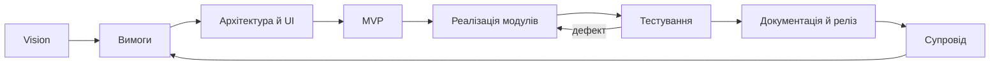
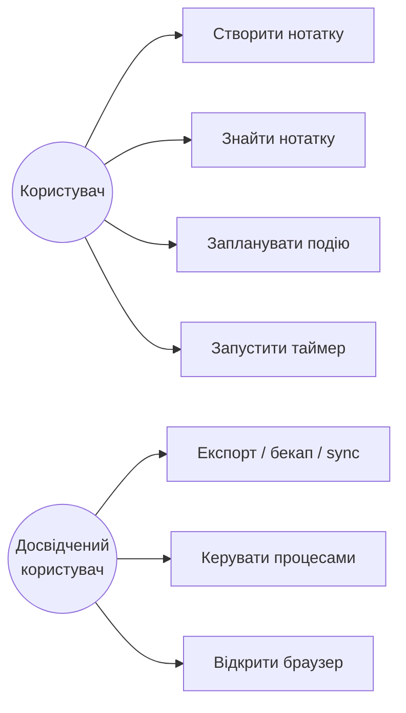

# Практичні роботи №1–20. Omnify

**Проєкт:** Omnify — локальний GTK 4-набір інструментів для Linux.
**Репозиторій:** <https://github.com/asdjfhaisufheirufiaref/omnify>
**Стан:** робочий застосунок, 439 автоматизованих тестів, усі проходять.
**Принцип звіту:** коротко — що зроблено, який артефакт і де це перевірити.

| Параметр | Значення |
| --- | --- |
| Мова / GUI | Python 3.10+ / GTK 4 (PyGObject) |
| Основні модулі | Dashboard, Notes, Calendar, Timer, Stopwatch, Alarm, Calculator, Task Manager, Browser, Settings |
| Формат нотаток | Markdown + front matter (`id`, `title`, `tags`, `pinned`, `updated_at`) |
| Дані | `notes/`, `~/.local/share/omnify/`; особисті дані не комітяться |
| Перевірка | `python3 -m unittest discover -s tests` → **439 OK** |

---

## 1. Вступ. Команда і Project Vision

**Мета:** сформувати команду, ролі, назву, проблему, аудиторію та бачення продукту.

- **Команда:** «Omnify Team»; формат — навчальний/індивідуальний.
- **Ролі:** Product Owner, аналітик, UI/UX-дизайнер, розробник, QA, документатор.
- **Продукт:** один локальний застосунок замість набору розрізнених програм.
- **Проблема:** дані розкидані, частина сервісів потребує акаунта, нотатки часто в закритих форматах.
- **Аудиторія:** студенти, викладачі, офісні працівники, користувачі Linux, люди, чутливі до приватності.

**Vision:**
> Omnify — локальний набір щоденних інструментів, який об'єднує нотатки, календар, час, калькулятор, задачі й браузер в одному вікні та зберігає дані у відкритих файлах.

**Стан:** ✅ Vision і ролі сформовано.

---

## 2. Проблема, користувачі та предметна область

**Проблема:** перемикання між багатьма програмами забирає час, а дані залишаються розрізненими та залежними від конкретного сервісу.

**Потреби:** швидкий запис, порядок, пошук, наочність, бекапи, приватність, контроль часу.

**Об'єкти предметної області:**

| Об'єкт | Зв'язок / призначення |
| --- | --- |
| `Note` | Нотатка; належить папці, має теги й картинки |
| `Folder` | Групує нотатки |
| `Tag` | Багато-до-багатьох із нотатками |
| `Asset` | Картинка нотатки в `assets/<note-id>/` |
| `CalendarEvent` / `Reminder` | Подія та нагадування |
| `Timer` / `Alarm` | Часові інструменти |
| `Process` | Системний процес у Task Manager |
| `Backup` | ZIP-архів нотаток |

**Основні сценарії:** створити нотатку; знайти за тегом; запланувати подію; запустити таймер; експортувати/відновити дані; завершити процес.

**Межі:** всередині — локальні дані, модулі, пошук, експорт, бекапи, локальна синхронізація. Ззовні — хмарний акаунт, мобільний клієнт, спільне редагування, офісний пакет.

**Стан:** ✅ Опис проблеми, аудиторії, об'єктів, зв'язків, сценаріїв і меж готовий.

---

## 3. Життєвий цикл програмного забезпечення

Порівняно Waterfall, V-model, Incremental, Spiral, Scrum, Kanban і Prototype. Для Omnify обрано **інкрементну ітеративну модель + Kanban**: продукт модульний, вимоги уточнюються, кожен інкремент перевіряється тестами.



**Чому так:** можна випускати окремі модулі, швидко отримувати зворотний зв'язок і не тримати весь проєкт в одному довгому Waterfall-етапі.

**Стан:** ✅ Модель і схема життєвого циклу.

---

## 4. Вимоги до програмного забезпечення

| ID | Вимога | Пріоритет |
| --- | --- | --- |
| FR-01 | Запуск застосунку та навігація між модулями | Must |
| FR-02 | Notes: створення, редагування, збереження, видалення | Must |
| FR-03 | Markdown-файли зі стабільним `id` | Must |
| FR-04 | Папки, теги, пошук, закріплення | Must/Should |
| FR-05 | Картинки, чеклісти, таблиці, preview | Must |
| FR-06 | HTML/PDF-експорт та імпорт Markdown | Should |
| FR-07 | ZIP-бекапи й відновлення | Must |
| FR-08 | Одно- та двостороння синхронізація з папкою | Should |
| FR-09 | Calendar, Timer, Stopwatch, Alarm | Must/Should |
| FR-10 | Settings: мова, теми, шрифти, фон | Should |

**Нефункціональні вимоги:** local-first; приватність; переносність даних; атомарний запис; відновлюваність; EN/UA; Linux + Python 3.10+; тестованість без GTK; безпека шляхів; робота без root.

**Пріоритети:** Must — запуск, Notes CRUD, збереження, таймери, базові налаштування; Should — папки, теги, preview, експорт, бекапи; Could — Task Manager, Browser, графіки.

**Стан:** ✅ FR/NFR, пріоритети та критерії приймання.

---

## 5. User Stories

| ID | User Story | Критерій приймання |
| --- | --- | --- |
| US-01 | Як студент, хочу швидко створити нотатку | `+` → назва → autosave → відновлення після перезапуску |
| US-02 | Як користувач, хочу групувати нотатки за папками | Створення, переміщення, фільтр; видалення папки не видаляє нотатки |
| US-03 | Як користувач, хочу теги й пошук | Пошук за назвою, текстом, тегом `#work` |
| US-04 | Як студент, хочу вставити картинку | `Ctrl+V`/`🖼` → файл у `assets/<id>/` |
| US-05 | Як користувач, хочу preview і чеклісти | Markdown-блоки видно; чекбокс змінює файл |
| US-06 | Як користувач, хочу експортувати нотатку | HTML/PDF відкриваються; картинки збережені |
| US-07 | Як користувач, хочу бекапи | ZIP, автоматично раз на добу, restore із safety backup |
| US-08 | Як користувач, хочу синхронізацію | Копіювання в папку та merge за `id` |
| US-09 | Як студент, хочу Pomodoro-таймер | Таймер працює у фоні, стан відновлюється |
| US-10 | Як користувач, хочу змінити мову/тему | EN/UA і тема зберігаються |

**Definition of Ready:** є роль, мета, критерії, оцінка.
**Definition of Done:** код, тести, локалізація, перевірка, commit.

**Стан:** ✅ Backlog і критерії приймання.

---

## 6. Use Case Diagram



- **UC-01 «Створити нотатку»:** `+` → редактор → autosave; альтернатива — порожня назва стає «Untitled».
- **UC-02 «Запланувати подію»:** дата → назва/час → нагадування; помилковий час не зберігається.
- **UC-03 «Запустити таймер»:** тривалість → Start → фон → звук; після перезапуску стан відновлюється.

**Стан:** ✅ Діаграма й три описані use cases.

---

## 7. Структура та класи

Основні компоненти: `app/shell.py` (вікно, sidebar), `core/` (storage, theme, i18n, context), `modules/` (інструменти), `notes_engine` (файли й модель), `notes_render` (HTML/PDF), `notes_preview` (GTK).

```mermaid
classDiagram
    class OmnifyApp { +run() +switch_to() }
    class BaseModule { <<abstract>> +build_view() +save_state() }
    class ModuleContext { +storage +theme +notify() }
    class Note { +id +label +contents +tags +folder +pinned }
    class NoteStore { +load() +save() +delete() +sync_two_way() }
    class NotesModule { +build_view() +refresh_preview() }
    OmnifyApp o-- BaseModule
    OmnifyApp --> ModuleContext
    BaseModule --> ModuleContext
    NotesModule --|> BaseModule
    NotesModule --> NoteStore
    NoteStore --> Note
```



**Рішення:** бізнес-логіка не імпортує GTK; стабільний `id`; Markdown замість закритої БД; атомарний запис; перевірка шляхів; спільний рендерер для preview/export.

**Стан:** ✅ Class Diagram і структура.

---

## 8. Інтерфейс користувача

**Екрани:** Dashboard, Notes, Calendar, Timer, Stopwatch, Alarm, Calculator, Task Manager, Browser, Settings.
**Навігація:** лівий sidebar; у Notes — список, редактор, preview, меню експорту/бекапів.

```text
┌────────────── Omnify ──────────────┐
│ Sidebar   │ Назва нотатки   📌 🖼  │
│ Notes     │ Теги: work, ideas      │
│ Calendar  │ [B][I][H][☑][▦][👁]    │
│ Timer     │ # План                 │
│ ...       │ - [x] зробити звіт     │
│           │ - [ ] перевірити тести │
│           │ 12 слів · Збережено    │
└────────────────────────────────────┘
```

**Сценарії:** створити нотатку → preview; знайти за тегом; вставити картинку; експортувати; зробити бекап; запустити таймер.

**Про Figma:** Figma — це інструмент для візуальних макетів, а не залежність застосунку. Вона потрібна лише тому, що практична №8 прямо вимагає прототип у Figma. У проєкті вже є **робочий GTK-прототип** і wireframes; Figma має сенс лише як формальний артефакт для викладача. Якщо вимога сувора — потрібен акаунт Figma; інакше достатньо застосунку й схем.

**Стан:** 🟡 Робочий прототип і wireframes є; Figma-посилання — лише за окремою вимогою.

---

## 9. Git і GitHub

```bash
git init
git add .
git commit -m "Add README and practical works report"
git remote add origin https://github.com/asdjfhaisufheirufiaref/omnify.git
git branch
git log --oneline --graph --decorate
git push origin main
```

- `.gitignore` виключає `__pycache__`, логи, `/notes/`, `/browser/`, `*.sqlite`, `*.db`.
- `notes/` не комітиться: особисті нотатки не потрапляють у публічний репозиторій.
- Перевірено: `origin/main` містить останній запушений коміт `c0aaf7e`; історія та remote налаштовані.
- Після останнього скорочення звіту потрібен ще один `git push`.

**Стан:** ✅ Основна частина виконана й опублікована; новий commit — за потреби.

---

## 10. Командна робота з Git

**Workflow:** `main` → `feature/<назва>` → зміни → тести → Pull Request → review → merge → видалення гілки.

```bash
git checkout main
git pull origin main
git checkout -b feature/notes-import
git add .
git commit -m "Add Markdown import"
git push -u origin feature/notes-import
```

**Конфлікт:** після `git rebase main` прибрати маркери `<<<<<<<`, `=======`, `>>>>>>>`, запустити тести, `git add`, `git rebase --continue`.

**Фактично:** проєкт індивідуальний, тому реальні PR між людьми не створювалися; локально використано окремі смислові коміти й перевірку тестами. Для повної командної практики потрібно створити PR на GitHub.

**Стан:** 🟡 Workflow описано й частково застосовано; PR — зовнішній крок.

---

## 11. Архітектура та структура

```text
omnify/
├── omnify/
│   ├── app/shell.py       # GTK Application, sidebar, stack
│   ├── core/              # storage, theme, i18n, context
│   ├── modules/           # notes, calendar, timer, calculator, ...
│   ├── locales/           # en.py, uk.py
│   └── main.py
├── tests/                 # unittest
├── README.md
├── PROJECT_STATUS.md
├── ПРАКТИЧНІ_РОБОТИ.md
└── pyproject.toml
```

| Шар | Відповідальність |
| --- | --- |
| `app` | Вікно, навігація, tray, Settings |
| `core` | JSON, теми, локалізація, контекст |
| `modules` | Функції окремих інструментів |
| `notes_engine` | Файли, модель, бекапи, sync |
| `notes_render` / `notes_preview` | Markdown → HTML/PDF/GTK |
| `tests` | Перевірка без обов'язкового дисплея |

**Стан:** ✅ Архітектурна схема і фактична структура.

---

## 12. Планування та MVP

**MVP:** запуск GTK-застосунку, Dashboard, Notes CRUD + пошук, Timer, Settings, локальне збереження.
**Додатково після MVP:** папки, теги, картинки, preview, бекапи, експорт, Calendar, Task Manager, Browser.

| Ітерація | Зміст |
| --- | --- |
| 0 | Каркас, `BaseModule`, Dashboard |
| 1 | Notes CRUD, autosave, перші тести |
| 2 | Папки, теги, пошук, preview, картинки |
| 3 | Бекапи, експорт, синхронізація, імпорт |
| 4 | Інші модулі, документація, реліз |

Порядок: каркас → нотатки → організація → надійність → інші модулі → тести → документація.

**Стан:** ✅ MVP і план ітерацій.

---

## 13. Перша робоча версія

Реалізовано модель `Note`, `NoteStore`, front matter, атомарний запис, список нотаток, редактор і автозбереження. Перший сценарій — **US-01 «Створити нотатку»**: `+` → назва → текст → `.md` на диску → відновлення після запуску.

```bash
python3 -m py_compile $(find omnify tests -name '*.py')
python3 -m unittest discover -s tests
git log --oneline
```

**Стан:** ✅ Робочий продукт і перші тести; історія в Git.

---

## 14. Функціональність та інтеграція

Реалізовано три історії:

1. **US-02 «Папки»** — `folders()`, `create_folder()`, `rename_folder()`, `delete_folder()`; нотатки після видалення папки переходять у «Без папки».
2. **US-05 «Preview і чеклісти»** — Markdown-парсер, GTK-preview, натискання чекбокса оновлює файл.
3. **US-07 «Бекапи»** — ZIP, автоматичний бекап раз на добу, 10 архівів, restore зі safety backup.

```bash
python3 -m unittest tests.test_notes_store -v
python3 -m unittest tests.test_notes_render -v
python3 -m unittest discover -s tests
```

**Стан:** ✅ Функції інтегровано; 439 тестів проходять.

---

## 15. Тестування

| ID | Перевірка | Очікування |
| --- | --- | --- |
| TC-01 | Створити нотатку, перезапустити | Нотатка на місці |
| TC-02 | Змінити назву | Файл перейменовано, `id` збережено |
| TC-03 | Пошук `#work` | Лише нотатки з тегом |
| TC-04 | Видалити папку | Нотатки в «Без папки» |
| TC-05 | Вставити картинку | Файл у `assets/<id>/` |
| TC-06 | Натиснути чекбокс | Markdown оновлено |
| TC-07 | Експорт HTML/PDF | Файли відкриваються |
| TC-08 | Відновити ZIP | Дані відновлено, є safety backup |
| TC-09 | Шлях `../secret` | Відмова, файл не читається |
| TC-10 | Імпорт із чужим `id` | Новий `id`, старі дані цілі |

Ручні smoke-перевірки охопили Notes, папки, preview, картинки, експорт, бекапи й запуск повного вікна. Відоме косметичне GTK-попередження про slider не впливає на роботу.

**Стан:** ✅ Позитивні, негативні та ручні сценарії; **439 OK**.

---

## 16. Автоматизоване тестування

Автоматизовано модель нотатки, `NoteStore`, Markdown-парсер, HTML/PDF, пошук, папки, бекапи, sync, імпорт, калькулятор і таймери. GTK-візуал перевіряється smoke-тестами.

```python
# приклад: файл нотатки
store.save(Note(label="Hello", contents="Text"))
loaded = store.load()
assert loaded[0].contents == "Text"

# приклад: експорт
assert html_path.is_file()
assert pdf_path.read_bytes()[:4] == b"%PDF"
```

```bash
python3 -m unittest discover -s tests
python3 -m unittest tests.test_notes_store -v
```

**Результат:** 439 тестів, OK; тести виявили крайові випадки з картинками, шляхами, id та синхронізацією.

**Стан:** ✅ Набір тестів і команди запуску.

---

## 17. Управління проєктом

**Kanban:** Backlog → Ready → In Progress → Review → Done. GitHub Projects/Trello потребують акаунта, тому дошку подано локально в цьому звіті.

| Backlog | У роботі | Done |
| --- | --- | --- |
| Хмарна синхронізація | — | Shell, Dashboard |
| Мобільний клієнт | — | Notes CRUD, папки, теги, пошук |
| Спільна робота | — | Preview, картинки, експорт |
| — | — | Бекапи, sync, імпорт Markdown |
| — | — | Calendar, Timer, Calculator |
| — | — | Task Manager, Browser, Settings |
| — | — | 439 тестів, README |

**Пріоритети:** P0 — запуск, Notes, Timer, Settings; P1 — папки, теги, preview, бекапи; P2 — експорт, sync, Task Manager; P3 — Browser, додаткові теми.

**Стан:** 🟡 Локальна Kanban-дошка; зовнішня дошка — за потреби.

---

## 18. Помилки та виправлення

| ID | Проблема | Причина / виправлення | Перевірка |
| --- | --- | --- | --- |
| OMN-01 | Не вставлялася картинка з буфера | Точне порівняння GType → `is_a()` | GTK smoke |
| OMN-02 | Pango-preview ламався на посиланнях | `<a>` → `<span underline>` | PDF/preview |
| OMN-03 | Залишалися порожні вкладені папки | Рекурсивне прибирання | Тест папок |
| OMN-04 | Кнопка тегу не оновлювалася одразу | Оновлення стану без затримки сигналу | Smoke-тест |
| OMN-05 | Імпорт міг перезаписати нотатку | Новий `uuid4` при колізії `id` | Тест імпорту |

**Стан:** ✅ 5 issues виправлено й повторно перевірено.

---

## 19. Зміна вимог: імпорт Markdown

**Нова вимога:** імпортувати зовнішні `.md`/`.markdown` у вибрану папку, зберігаючи назву, теги та вміст.

**Вплив:** `notes_engine.import_markdown()`, пункт меню й FileChooser у `notes.py`, локалізація, тести, README.

**Реалізація:**

- копія створюється в `notes/`, джерело не змінюється;
- metadata зберігається;
- при колізії `id` генерується новий;
- додано тести на копіювання та колізію.

```bash
python3 -m unittest discover -s tests
```

**Результат:** **439 OK**; commit `4cb265a Add Markdown import for external notes`.

**Стан:** ✅ Вимогу реалізовано й задокументовано.

---

## 20. Документація та презентація

- **README.md:** опис, можливості, залежності, запуск, Notes, структура, тести, приклади, обмеження.
- **PROJECT_STATUS.md:** технічний стан, архітектура, Notes, checklist.
- **Цей файл:** короткий звіт за 20 практичними.
- **Демо:** запуск → Dashboard → Notes → створити нотатку → preview → картинка → експорт → бекап → Timer → тести.
- **Презентація, 10 слайдів:** проблема, користувачі, вимоги, архітектура, UI, демо Notes, тестування, Git, результати, плани.

**Стан:** ✅ README, звіт, приклади й сценарій демонстрації.

---

## Підсумок

| № | Практична | Стан |
| --- | --- | --- |
| 1 | Vision і команда | ✅ |
| 2 | Проблема та домен | ✅ |
| 3 | Життєвий цикл | ✅ |
| 4 | Вимоги | ✅ |
| 5 | User Stories | ✅ |
| 6 | Use cases | ✅ |
| 7 | Структура та класи | ✅ |
| 8 | UI-прототип | 🟡 GTK-прототип; Figma лише за вимогою |
| 9 | Git/GitHub | ✅ Запушено до `c0aaf7e`; новий commit — за потреби |
| 10 | Командний Git | 🟡 Workflow є; PR — зовнішній крок |
| 11 | Архітектура | ✅ |
| 12 | MVP | ✅ |
| 13 | Перша версія | ✅ |
| 14 | Функціональність | ✅ |
| 15 | Тестування | ✅ |
| 16 | Автотести | ✅ 439 OK |
| 17 | Kanban | 🟡 Локальна дошка |
| 18 | Помилки | ✅ 5 fixes |
| 19 | Зміна вимог | ✅ |
| 20 | Документація | ✅ |

```bash
python3 -m py_compile $(find omnify tests -name '*.py')
python3 -m unittest discover -s tests
git status
git log --oneline --graph --decorate -10
```

**Figma:** для роботи застосунку не потрібна. Це лише формальна вимога практичної №8 до візуального макета; фактичний прототип уже реалізовано на GTK.
